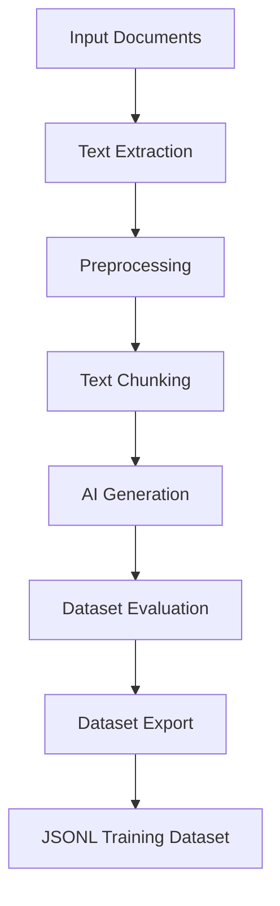
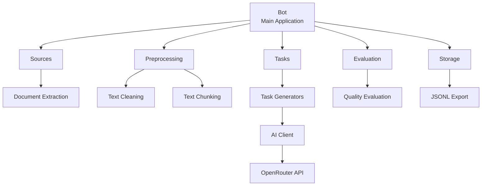
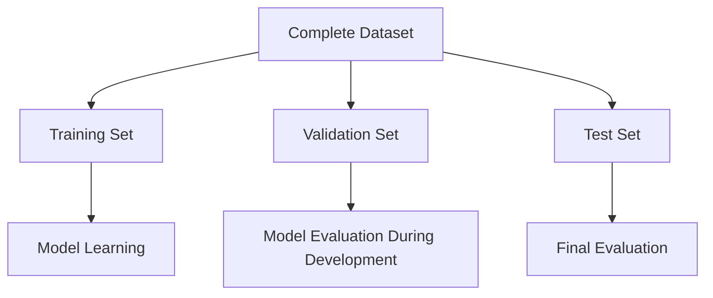

# Training Data Bot

**An AI-powered pipeline for transforming raw text into structured training datasets.**

Training Data Bot is a Python project designed to automate the preparation of datasets for AI and machine learning applications.

It takes raw text documents, processes their content, divides them into manageable chunks, and uses an AI language model to generate structured training examples.

The goal is to simplify one of the important stages of building AI systems: **preparing high-quality data that can be used to train, fine-tune, and evaluate models.**

---

## Table of Contents

1. [Project Overview](#-project-overview)
2. [Why This Project?](#-why-this-project)
3. [How It Works](#-how-it-works)
4. [Architecture](#-project-architecture)
5. [Project Structure](#-project-structure)
6. [Main Components](#-main-components)
7. [AI Integration](#-ai-integration)
8. [Generated Dataset](#-generated-dataset)
9. [Installation](#-installation)
10. [Configuration](#-configuration)
11. [Running the Project](#-running-the-project)
12. [Example Workflow](#-example-workflow)
13. [Using the Generated Data](#-using-the-generated-data)
14. [Current Limitations and Future Improvements](#-current-limitations-and-future-improvements)
15. [Technologies Used](#-technologies-used)

---

## 🤖 Project Overview

Training Data Bot is a modular Python application that automates the generation of AI training examples from existing text documents.

Instead of manually writing hundreds of questions, answers, and summaries, the application uses an AI model to generate them automatically.

### Main capabilities

- **Text extraction:** Reads source documents and extracts their content.
- **Preprocessing:** Cleans and prepares extracted text.
- **Text chunking:** Divides large documents into smaller pieces.
- **AI generation:** Uses an AI language model to generate training examples.
- **Multiple generation tasks:** Supports question-answer generation, text classification, and summarization.
- **Dataset evaluation:** Includes an evaluation stage to assess generated data.
- **Dataset management:** Exports generated examples into JSONL format.

### Supported generation tasks

| Task | Description | Example application |
|---|---|---|
| Question & Answer | Generates questions and answers from source text | Educational assistants |
| Summarization | Produces shorter versions of text | Document summarization |
| Classification | Assigns categories to text | Text categorization |

---

## 💡 Why This Project?

Training an AI model requires data that is properly structured and suitable for the intended task.

However, raw documents are not automatically ready to be used as training data.

For example, consider a document containing information about artificial intelligence:

**Original source text:**

> Artificial intelligence is a field of computer science that focuses on creating systems capable of performing tasks that normally require human intelligence.

A training dataset could contain:

**Question:**

What is artificial intelligence?

**Answer:**

Artificial intelligence is a field of computer science that focuses on creating systems capable of performing tasks that normally require human intelligence.

The same source can also be transformed into a summary or a classification example.

This project automates that transformation.

---

## ⚙️ How It Works

The application follows a pipeline architecture.

Each stage is responsible for a specific part of the data preparation process.

### General workflow



### Explanation of each stage

**1. Input documents**

The pipeline starts with source documents, such as text files and supported document formats.

**2. Text extraction**

The application extracts readable text from the source documents.

**3. Preprocessing**

The extracted text is cleaned and prepared for further processing.

**4. Text chunking**

Large documents are divided into smaller text sections called chunks.

Chunking makes it easier to process large documents without sending the entire document to the AI model at once.

**5. AI generation**

The generated chunks are passed to task-specific generators.

Depending on the selected task, the AI produces questions and answers, summaries, or classifications.

**6. Dataset evaluation**

The project includes an evaluation stage intended to assess the generated examples.

**7. Dataset export**

The generated examples are stored in JSONL format, making them easier to process with other Python tools and AI training frameworks.

---

## 🏗️ Project Architecture

The project is organized into separate modules to keep responsibilities independent and make the application easier to maintain.

### Architecture diagram



The main application coordinates the different components.

The AI client communicates with an external language model provider through an API, while the other modules handle data preparation, generation, evaluation, and storage.

---

## 📁 Project Structure

The repository follows a modular Python package structure.

```text
training-data-bot/
│
├── data/
│   ├── input/
│   │   └── example.txt
│   │
│   └── output/
│       └── training_dataset.jsonl
│
├── examples/
│   └── qiuckstart.py
│
├── tests/
│
├── training_data_bot/
│   │
│   ├── ai/
│   │   ├── client.py
│   │   └── exceptions.py
│   │
│   ├── core/
│   │
│   ├── decodo/
│   │
│   ├── evaluation/
│   │
│   ├── preprocessing/
│   │
│   ├── sources/
│   │
│   ├── storage/
│   │
│   ├── tasks/
│   │
│   ├── bot.py
│   └── __init__.py
│
├── .env
├── .gitignore
├── requirements.txt
└── README.md
```

### Directory descriptions

| Directory | Responsibility |
|---|---|
| `data/input/` | Contains source documents |
| `data/output/` | Stores generated datasets |
| `examples/` | Contains example scripts for running the application |
| `tests/` | Contains project tests |
| `ai/` | Handles communication with AI providers |
| `core/` | Contains core models and shared application components |
| `decodo/` | Additional project module |
| `evaluation/` | Handles dataset evaluation |
| `preprocessing/` | Cleans and prepares text |
| `sources/` | Handles source document input |
| `storage/` | Handles saving and exporting data |
| `tasks/` | Contains task-specific generators |

**Important:** The folder structure separates the application into independent components. This makes it possible to improve one part without rewriting the entire application.

---

## 🧩 Main Components

### 1. The main bot

**File:** `training_data_bot/bot.py`

The bot acts as the central coordinator of the application.

Its responsibilities include:

- Initializing the different components.
- Selecting the AI provider.
- Coordinating document processing.
- Running the generation tasks.
- Managing evaluation and dataset export.

The bot connects the different modules into one complete workflow.

### 2. The AI client

**File:** `training_data_bot/ai/client.py`

The AI client is responsible for communicating with an external language model.

The project currently uses an OpenAI-compatible chat completions interface through OpenRouter.

Its main responsibilities include:

- Loading the API key from environment variables.
- Sending prompts to the configured model.
- Setting generation parameters.
- Handling HTTP errors.
- Extracting the generated response.

The AI client is designed to separate API communication from the rest of the application.

This means the task generators do not need to know the technical details of HTTP requests.

### 3. Task generators

**File:** `training_data_bot/tasks/generators.py`

Task generators define what the AI should produce from each text chunk.

The project includes three generator types:

**QAGenerator**

Generates a question and its answer based on the source text.

**SummarizationGenerator**

Produces a concise summary of the source text.

**ClassificationGenerator**

Assigns a category to the source text and provides a brief explanation.

The generators use prompt templates and configurable parameters such as temperature and maximum output tokens.

### 4. Data models

**Directory:** `training_data_bot/core/`

Data models define the structure of the information exchanged between application components.

Examples include:

- `TextChunk`
- `TrainingExample`
- `TaskTemplate`
- `TaskResult`

Using structured models makes it easier to validate and organize application data.

### 5. Preprocessing

**Directory:** `training_data_bot/preprocessing/`

The preprocessing stage prepares extracted text for AI generation.

Its role is to ensure that the input is suitable for chunking and further processing.

### 6. Evaluation

**Directory:** `training_data_bot/evaluation/`

This module is responsible for evaluating generated training data.

Evaluation is important because automatically generated examples are not necessarily accurate or useful.

A generated example should be checked for relevance, correctness, and consistency with its source.

### 7. Storage

**Directory:** `training_data_bot/storage/`

The storage module handles saving generated data.

The project exports training examples using JSONL, a format commonly used in data-processing and machine-learning workflows.

---

## 🧠 AI Integration

Training Data Bot uses an external AI model rather than running a large language model locally.

The current integration uses:

- **Provider:** OpenRouter
- **API style:** OpenAI-compatible chat completions
- **HTTP library:** HTTPX
- **Configuration:** Environment variables

### Why OpenRouter?

OpenRouter provides access to different language models through a unified API.

This allows the project to change models without completely rewriting the AI client.

### Model configuration

The model is configurable through the application configuration.

For example:

```python
config = {
    "use_mock_ai": False,
    "model": "nvidia/nemotron-3.5-lightning:free",
}
```

The exact model identifier can be changed depending on availability and compatibility.

**Note:** Free model availability, usage limits, and API behavior may change over time.

### Mock AI provider

The project also supports a mock AI provider.

A mock provider is useful during development and testing because it allows the application to run without making real API requests.

For example:

```python
config = {
    "use_mock_ai": True,
}
```

---

## 📦 Generated Dataset

The generated dataset is exported into a JSONL file.

JSONL stands for **JSON Lines**.

Unlike a regular JSON file containing one large array, JSONL stores one independent JSON object per line.

### Example

```json
{"input_text":"Artificial intelligence is a field of computer science.","output_text":"**Question:** What is artificial intelligence?\n\n**Answer:** Artificial intelligence is a field of computer science.","task_type":"qa_generation","source_document_id":"document_id","source_chunk_id":"chunk_id","quality_scores":{},"split":"train"}
```

Each record represents one training example.

### Dataset fields

| Field | Description |
|---|---|
| `input_text` | Original text provided to the model |
| `output_text` | Generated response or target output |
| `task_type` | Type of generation task |
| `source_document_id` | Identifier of the original document |
| `source_chunk_id` | Identifier of the source chunk |
| `quality_scores` | Quality scores associated with the example, when available |
| `split` | Dataset partition, such as train, validation, or test |

### Understanding the dataset splits

The generated dataset can be divided into three subsets:



- **Training set:** Used to teach the model.
- **Validation set:** Used to monitor model performance during development.
- **Test set:** Used to evaluate the model on examples not used during training.

For reliable evaluation, related examples from the same source document or chunk should not accidentally appear in different splits.

---

## 🚀 Installation

### Prerequisites

Before running the project, make sure you have:

- Python 3.10 or newer (the project has been developed and tested with Python 3.12).
- Git.
- A code editor such as Visual Studio Code.
- An OpenRouter API key if you want to use a real AI model.

### 1. Clone the repository

```bash
git clone https://github.com/vision-b/training-data-bot
```

Navigate into the project:

```bash
cd training-data-bot
```

### 2. Create a virtual environment

```bash
python -m venv .venv
```

### 3. Activate the virtual environment

**Windows PowerShell:**

```powershell
.venv\Scripts\Activate.ps1
```

**Linux / macOS:**

```bash
source .venv/bin/activate
```

### 4. Install dependencies

```bash
pip install -r requirements.txt
```

---

## 🔑 Configuration

The project uses environment variables to store sensitive configuration information.

Create a `.env` file in the project root:

```env
OPENROUTER_API_KEY=your_openrouter_api_key
```

Replace the placeholder with your own API key.

Never upload your real API key to GitHub.

Make sure `.env` is included in `.gitignore`:

```gitignore
.env
.venv/
__pycache__/
*.pyc
```

---

## ▶️ Running the Project

The example script demonstrates how to initialize and run the application.

Run it from the project root:

```bash
python examples/qiuckstart.py
```

The example script uses the application configuration to select the AI provider and generation settings.

To use the real AI provider, configure:

```python
config = {
    "use_mock_ai": False,
}
```

To use the mock provider:

```python
config = {
    "use_mock_ai": True,
}
```

After successful execution, the generated dataset is exported to:

```text
data/output/training_dataset.jsonl
```

---

## 🔬 Example Workflow

Suppose the input file contains information about artificial intelligence.

**Input:**

```text
Artificial intelligence is a field of computer science.

Machine learning is a subset of artificial intelligence
that allows systems to learn from data.

Deep learning uses neural networks with multiple layers.
```

The bot processes the document and generates examples.

### Possible generated question-and-answer example

```text
Question:
What is machine learning?

Answer:
Machine learning is a subset of artificial intelligence
that allows systems to learn from data.
```

### Possible generated summary

```text
Artificial intelligence is a field of computer science.
Machine learning allows systems to learn from data,
while deep learning uses multilayer neural networks.
```

### Result

The generated examples are saved as separate JSONL records.

These records can then be inspected, evaluated, filtered, and prepared for a compatible training framework.

---

## 🎯 Using the Generated Data

The main purpose of the project is to prepare structured datasets for AI applications.

There are several possible uses.

### 1. Fine-tuning language models

Fine-tuning is a process in which an existing pretrained model is further trained using a specialized dataset.

For example, a dataset containing question-and-answer pairs could help adapt a model to answer questions in a particular format or domain.

### 2. Building educational assistants

A dataset generated from educational documents could be used to develop an assistant that:

- Answers questions about course material.
- Produces summaries.
- Explains concepts.
- Helps organize educational information.

### 3. Text classification

Classification examples can be used to train or adapt models to categorize text into predefined classes.

### 4. Summarization systems

Summarization examples can be used to adapt models to produce summaries according to specific requirements.

### Fine-tuning vs. RAG

These are two different approaches to working with document knowledge.

| Fine-tuning | Retrieval-Augmented Generation (RAG) |
|---|---|
| Adapts a model using training examples | Retrieves relevant document information |
| Changes learned model behavior | Supplies external context at response time |
| Useful for consistent formats and task behavior | Useful for answering questions about changing or specific documents |

A document-based chatbot often benefits from RAG. Fine-tuning is useful when the goal is to adapt how a model performs a task.

The generated dataset from this project is more directly related to the fine-tuning and training-data preparation workflow.

---

## ⚠️ Current Limitations and Future Improvements

This project is a work in progress.

Although the main generation pipeline is functional, several areas can be improved.

### Current limitations

- Generated examples still require quality verification.
- Text chunking can split sentences or ideas across chunk boundaries.
- Generated summaries may contain repetitive wording.
- Dataset evaluation and quality-score propagation need further verification.
- Small datasets are not sufficient for reliable model evaluation or meaningful fine-tuning.
- The current pipeline prepares datasets but does not itself perform model fine-tuning.

### Planned improvements

- [ ] Improve chunking to preserve sentence and paragraph boundaries.
- [ ] Add overlapping chunks where appropriate.
- [ ] Improve generated-example quality evaluation.
- [ ] Ensure evaluation scores are correctly associated with dataset examples.
- [ ] Improve train/validation/test splitting to prevent data leakage.
- [ ] Support additional document formats.
- [ ] Add more generation tasks.
- [ ] Improve error handling and logging.
- [ ] Add more automated tests.
- [ ] Add dataset filtering and deduplication.
- [ ] Add export formats compatible with popular fine-tuning frameworks.
- [ ] Explore an additional model-training or fine-tuning stage.

---

## 🛠️ Technologies Used

| Technology | Purpose |
|---|---|
| Python | Main programming language |
| OpenRouter | Access to hosted language models |
| HTTPX | Asynchronous HTTP requests |
| Pydantic | Structured data models and validation |
| python-dotenv | Environment-variable configuration |
| PyMuPDF | PDF processing |
| JSONL | Dataset export format |
| Git | Version control |

---

## 📚 Key Concepts Demonstrated

This project is also an opportunity to explore several important software engineering and AI concepts:

- Python object-oriented programming.
- Modular application architecture.
- Asynchronous programming.
- HTTP APIs and external AI services.
- Environment-variable management.
- Data models and validation.
- Text preprocessing and chunking.
- Prompt engineering.
- Automated data generation.
- Dataset evaluation.
- JSONL data processing.
- Testing and error handling.

---

## 📌 Project Status

**Development status:** Work in progress.

The project currently demonstrates a working data-preparation pipeline that can process text, generate AI-based training examples, and export them into JSONL format.

The next major objective is to strengthen dataset quality and reliability before introducing a model fine-tuning stage.

---

## 👨‍💻 Author

Developed as a Python and AI engineering learning project.

**Repository:** Training Data Bot

---

*Training Data Bot — Turning raw text into structured AI training data.*
